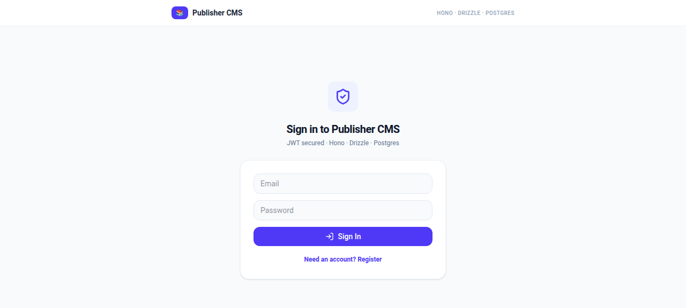
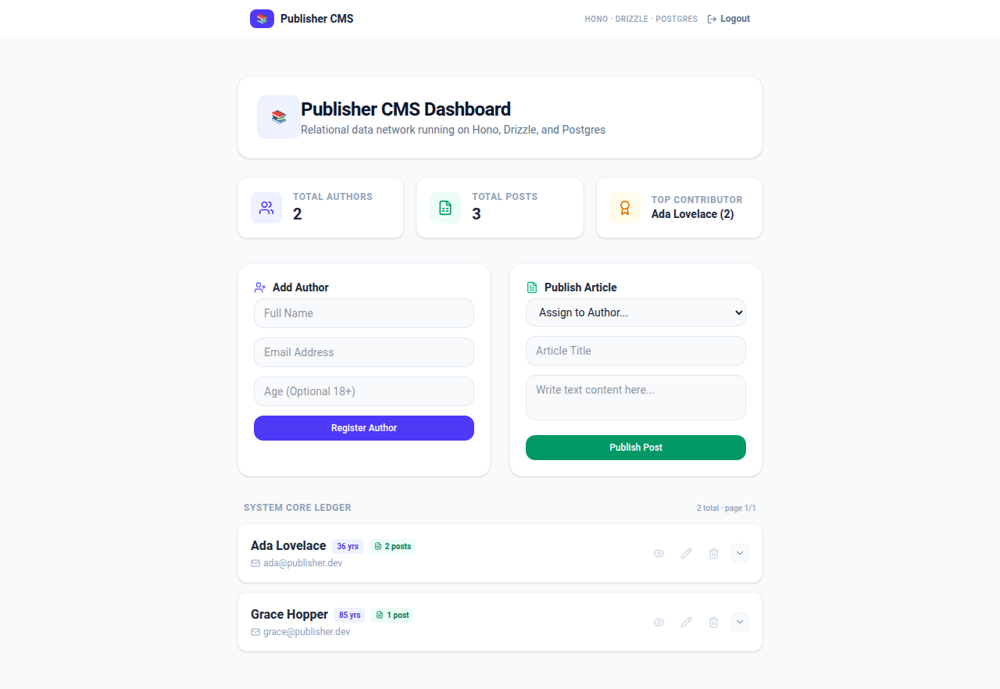
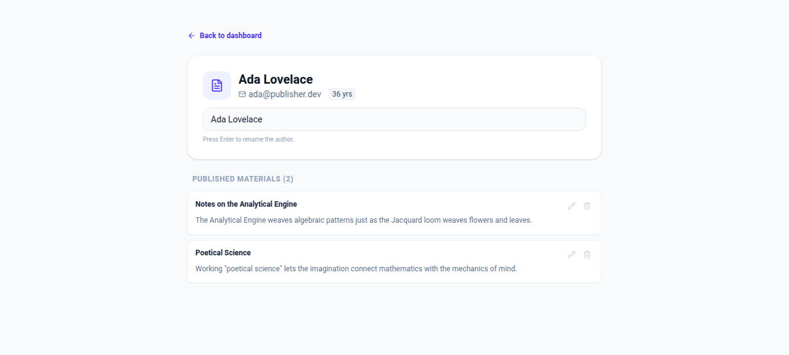

# Publisher CMS & Author Analytics Dashboard

[](https://github.com/Shahbaz2104/hono-api/actions/workflows/backend-tests.yml)
[](LICENSE)

A type-safe full-stack content management system with JWT authentication, a paginated REST API, and a live analytics dashboard. Built as a clean split between a high-performance backend and a responsive admin frontend — with runtime validation, cascade deletion safety, and server-side analytics.

<!-- DEMO-START
## 🖥️ Demo





https://github.com/Shahbaz2104/hono-api/assets/docs/screenshots/demo.gif

Capture instructions: [docs/DEMO.md](docs/DEMO.md)
DEMO-END -->

---

# 🏗 Architecture

A unified monorepo containing two decoupled domains:

* **`backend/`** — Hono REST API with Zod validation, Drizzle ORM on **PostgreSQL**, and JWT auth (bcryptjs + jose).
* **`frontend/`** — Vite + React + TypeScript dashboard using TanStack Query, Tailwind CSS, and Sonner toasts.

---

# 🛠 Tech Stack

## Backend

| Layer | Choice |
| --- | --- |
| Framework | [Hono](https://hono.dev) |
| Database | **PostgreSQL** |
| ORM | [Drizzle ORM](https://orm.drizzle.team) + Drizzle Kit |
| Validation | [Zod](https://zod.dev) via `@hono/zod-validator` |
| Auth | JWT (HS256, [jose](https://github.com/panva/jose)) + [bcryptjs](https://github.com/kelektiv/node.bcrypt.js) |
| Tests | [Vitest](https://vitest.dev) + [PGlite](https://pglite.dev) (in-process Postgres) |

## Frontend

| Layer | Choice |
| --- | --- |
| Framework | Vite + React + TypeScript |
| Server state | [TanStack Query v5](https://tanstack.com/query/latest) |
| Styling | [Tailwind CSS](https://tailwindcss.com) |
| Toasts | [Sonner](https://sonner.emilkowal.ski) |
| Icons | [Lucide React](https://lucide.dev) |
| Routing | [React Router v7](https://reactrouter.com) |

---

# 📦 Directory Structure

```text
Hono Api/
├── backend/
│   ├── src/
│   │   ├── db/            # Drizzle schema + client
│   │   ├── lib/           # Shared helpers (db error codes)
│   │   ├── middleware/    # Bearer JWT middleware
│   │   ├── routes/        # auth.ts, author.ts
│   │   ├── test/          # Vitest suite (PGlite-backed)
│   │   ├── app.ts         # App factory (DI-friendly)
│   │   ├── env.ts         # Validated env schema
│   │   └── index.ts       # Entrypoint
│   ├── drizzle/           # Generated SQL migrations
│   ├── drizzle.config.ts
│   ├── vitest.config.ts
│   └── package.json
│
├── frontend/
│   ├── src/
│   │   ├── components/    # Forms, list, modals, ProtectedRoute
│   │   ├── hooks/         # useAuthors, useAuthor, useAuthorStats, ...
│   │   ├── lib/           # api client, token storage, types
│   │   ├── pages/         # Dashboard, AuthorDetail, Login
│   │   └── App.tsx
│   └── package.json
│
└── README.md
```

---

# 🔐 Authentication

All `/author` routes require a JWT bearer token. `/auth/*` and `GET /` are public.

* **Register** — `POST /auth/register` hashes the password (bcrypt, cost 10) and stores a `users` row. Duplicate emails return `409`.
* **Login** — `POST /auth/login` verifies credentials and returns a 7-day HS256 JWT signed with `JWT_SECRET`.
* **Middleware** — `backend/src/middleware/auth.ts` verifies tokens with `jose`, rejects missing/invalid/expired tokens with `401`, and injects `userId` into the request context.
* **Frontend** — the token is stored in `localStorage` and attached to every request. On a `401`, the client clears the token and redirects to `/login`.

> **Note:** localStorage tokens are appropriate for this demo. For production, prefer httpOnly cookies with CSRF protection.

---

# 📊 Database Schema

A **one-to-many** relationship between authors and posts with cascading deletes:

```typescript
export const authorsTable = pgTable('authors', {
  id: serial('id').primaryKey(),
  name: text('name').notNull(),
  email: text('email').notNull().unique(),
  age: integer('age'),
});

export const postsTable = pgTable('posts', {
  id: serial('id').primaryKey(),
  title: text('title').notNull(),
  content: text('content').notNull(),
  authorId: integer('author_id')
    .notNull()
    .references(() => authorsTable.id, { onDelete: 'cascade' }),
});
```

There is also a `users` table (`email`, `passwordHash`, `createdAt`) that backs authentication.

---

# 📡 API Reference

Base URL: `http://localhost:3000`

### Auth (public)

| Method | Route | Validation | Purpose | Status |
| --- | --- | --- | --- | --- |
| `POST` | `/auth/register` | email + password (min 8) | Create account | `201` / `409` |
| `POST` | `/auth/login` | email + password | Get JWT | `200` / `401` |

### Authors & Posts (JWT required)

| Method | Route | Validation | Purpose | Status |
| --- | --- | --- | --- | --- |
| `GET` | `/author` | `?page=&limit=` (max 100) | Paginated authors + posts | `200` / `400` |
| `GET` | `/author/stats` | None | Server-side analytics | `200` |
| `GET` | `/author/options` | None | Lightweight `{id, name}` list | `200` |
| `GET` | `/author/:id` | Positive int param | Single author + posts | `200` / `404` |
| `POST` | `/author` | `createAuthorSchema` | Create author | `201` / `400` |
| `PATCH` | `/author/:id` | Non-empty partial | Update author | `200` / `400` / `404` |
| `DELETE` | `/author/:id` | Positive int param | Delete author + cascade posts | `200` / `404` |
| `POST` | `/author/post` | `createPostSchema` | Create post | `201` / `400` |
| `PATCH` | `/author/post/:id` | Non-empty partial | Update post | `200` / `400` / `404` |
| `DELETE` | `/author/post/:id` | Positive int param | Delete single post | `200` / `404` |

### Pagination

`GET /author?page=1&limit=20` returns:

```json
{
  "items": [ { "id": 1, "name": "Ada Lovelace", "email": "...", "age": 30, "posts": [] } ],
  "page": 1,
  "limit": 20,
  "total": 42,
  "totalPages": 3
}
```

`limit` is capped at 100; out-of-range values return `400`.

### Analytics

`GET /author/stats` computes totals with SQL (not client-side), so numbers stay correct across pages:

```json
{
  "totalAuthors": 12,
  "totalPosts": 34,
  "topAuthor": { "name": "Ada Lovelace", "postCount": 8 }
}
```

---

# ✅ Validation & Error Handling

Requests are validated with Zod **before** touching the database. Errors are structured and predictable:

```json
{ "success": false, "message": "Email address already registered" }
```

Database constraint violations are mapped to friendly responses (unique email → `400`/`409`, foreign key → `400`). Empty `PATCH` bodies are rejected instead of silently no-op'ing. The frontend surfaces these as Sonner toasts.

---

# ⚡ Getting Started

## 1. Backend

```bash
cd backend
npm install

# Configure environment (see below), then:
npx drizzle-kit push   # apply schema to Postgres
npm run dev            # http://localhost:3000
```

### Environment (`backend/.env`)

```bash
DATABASE_URL=postgres://shahbaz@/publisher_cms?host=/var/run/postgresql
PORT=3000
NODE_ENV=development
JWT_SECRET=<random 32+ character string>   # e.g. openssl rand -base64 32
CLIENT_ORIGIN=http://localhost:5173
```

`JWT_SECRET` and `DATABASE_URL` are required (the server refuses to boot without them). Copy `.env.example` as a starting point.

## 2. Frontend

```bash
cd frontend
npm install
npm run dev            # http://localhost:5173
```

Vite proxies `/author` and `/auth` to the backend, so no frontend env config is needed.

---

# 🧪 Testing

The backend ships with a **Vitest** suite that runs against **PGlite** — a real Postgres compiled to WASM. No external database, containers, or network needed:

```bash
cd backend
npm test               # single run
npm run test:watch     # watch mode
```

**32 tests** cover:

* Auth — register/login happy paths, duplicate email `409`, weak password `400`, wrong password `401`
* Middleware — missing token, garbage token, and wrongly-signed tokens all rejected `401`
* Pagination — envelope shape, page slicing, limit cap, invalid page rejection
* CRUD — create/read/update/delete for authors and posts, `404`s, empty-body `400`s
* Cascade — deleting an author removes their posts (verified via stats endpoint)

---

# 🚀 Key Features

* JWT authentication with hashed passwords (bcrypt) and signed tokens (jose)
* Type-safe full-stack architecture
* Runtime validation with Zod on every write
* PostgreSQL persistence via Drizzle ORM
* Cursor-free offset pagination with server-computed totals
* SQL-side analytics (survives pagination)
* Cascade deletion safety
* Reactive dashboard with TanStack Query cache invalidation
* Toast-based feedback (Sonner) on every mutation
* In-process integration tests (Vitest + PGlite)
* Validated environment variables (fail-fast boot)
* Dependency-injected app/database factories (testable by design)
